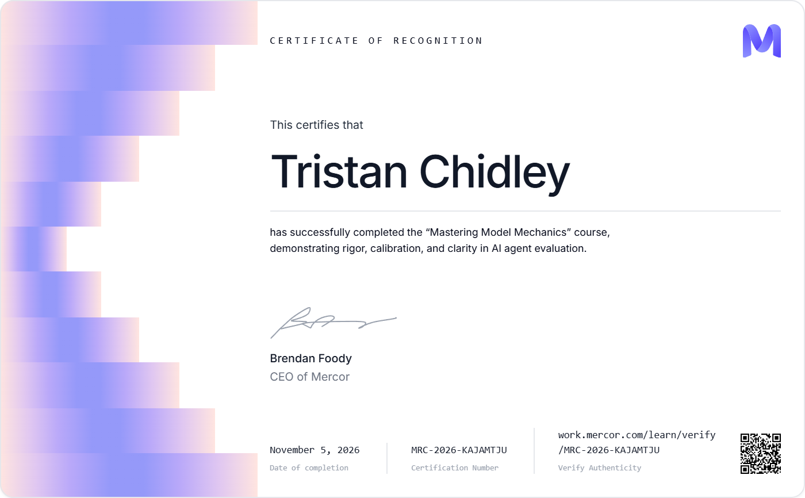
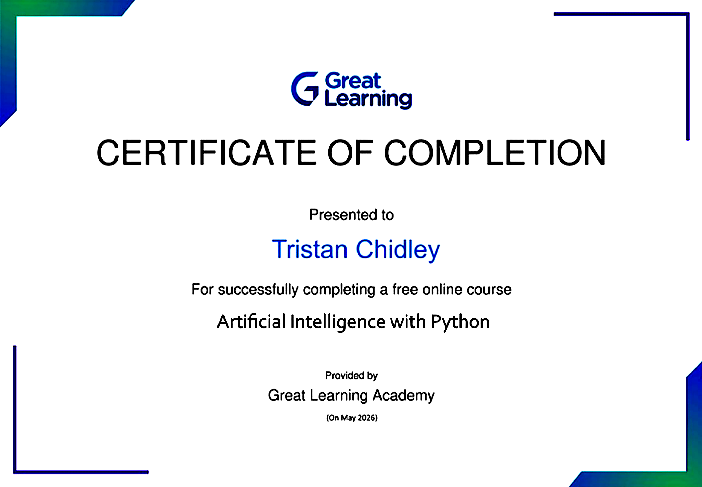
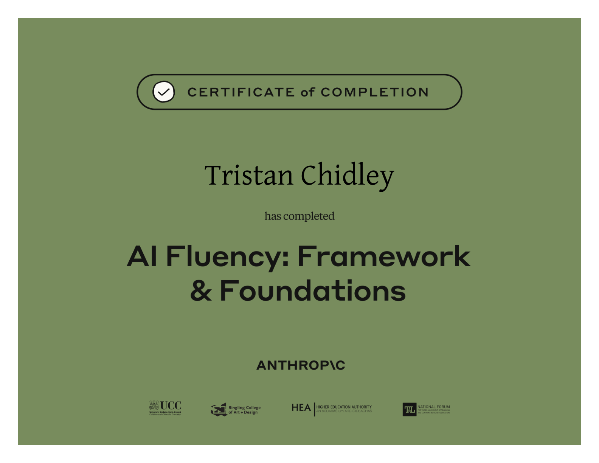
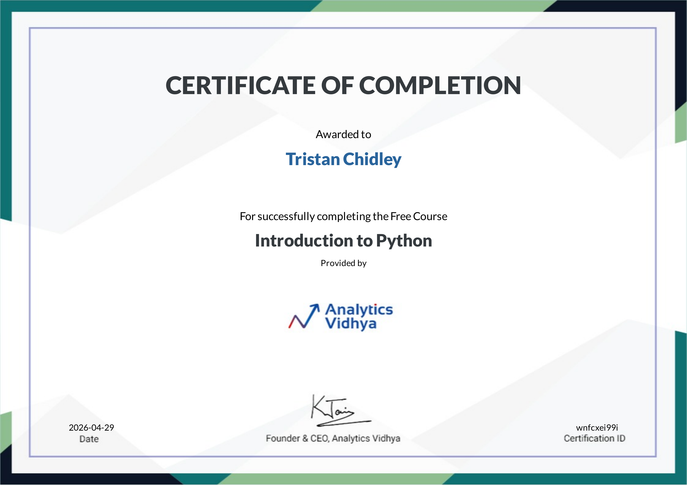

  

<h1 align="center">Tristan Chidley</h1>

<h3 align="center">Chemistry | Python | Artificial Intelligence</h3>

  Exploring the intersection of science, programming,
  artificial intelligence and creative technology.

---

## 👨‍💻 About Me

- 🎓 Background in Chemistry and Materials Science
- 🐍 Developing Python programming projects
- 🤖 Interested in Artificial Intelligence and Machine Learning
- ⚡ Creating animated visual effects using Python
- 🔬 Interested in scientific computing and computational chemistry

## 🛠️ Technologies & Tools

<table>
<tr>
<td align="center"></td>
<td align="center"></td>
<td align="center"></td>
<td align="center"></td>
<td align="center"></td>
<td align="center"></td>
<td align="center"></td>
</tr>
</table>

## 🚀 Featured Projects

More projects coming soon!

## 📊 GitHub Statistics

  
  &nbsp;&nbsp;&nbsp;&nbsp;
  

## 🏆 Certifications & Achievements

<table>
  <tr>
    <td></td>
    <td></td>
    <td></td>
    <td></td>
    <td></td>
    <td><a href="https://courses.analyticsvidhya.com/certificates/wnfcxei99i"></td>
  </tr>
</table>

## 🐍 My GitHub Contribution Snake

---

  Thanks for visiting my profile!

